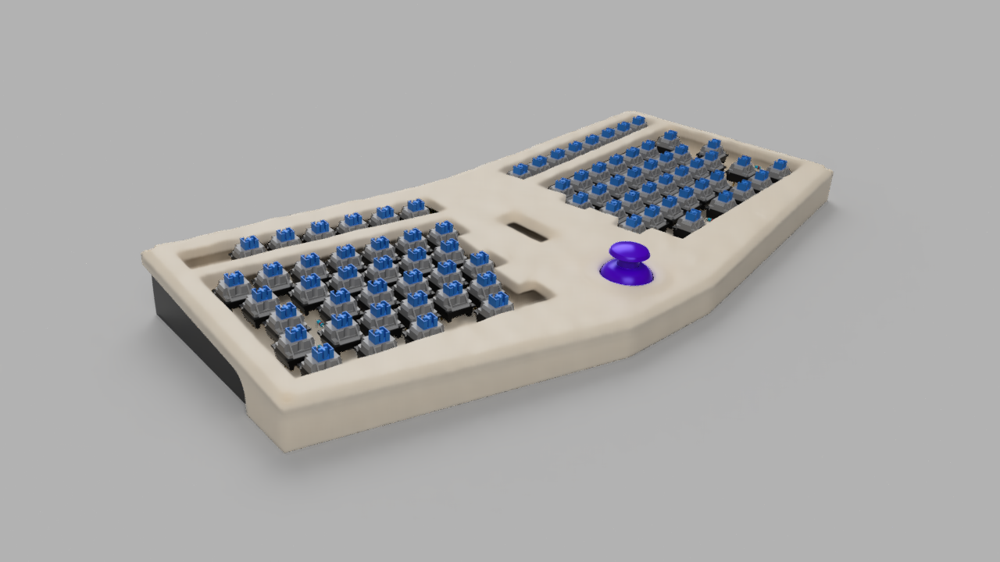
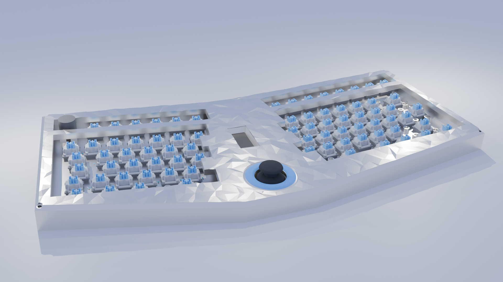
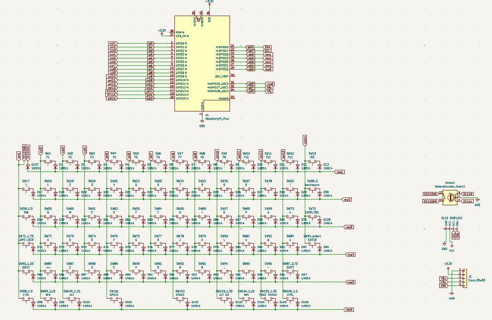
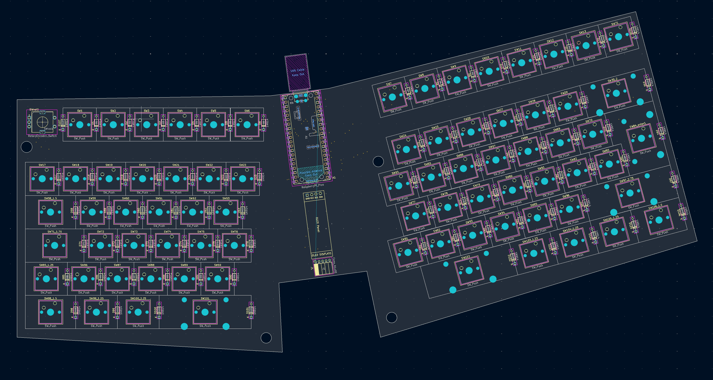
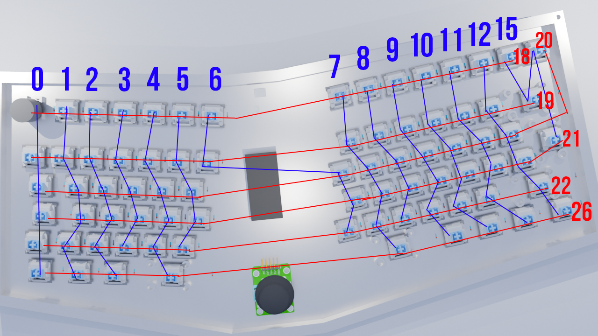

# ***THE BUCKBOARD***

The buckboard is a 60% keyboard with a integrated joystick that simulates the arrow keys and a tiny oled screen.
This project uses a raspberry pi pico as microcontroller.
Altough the project offers a pcb for the keyboard, the case is made for hand wired keyboard and it should be used just for reference on how to wire up everything (still you could use the pcb, you just need to make some adjustments to the bottom part of the case)

## **CASE**

the case 3d files can be found in /case

## **SCHEMATIC**

This is the schematich for the wiring of the keyboard, each key has its own key written down for ease of use

Each key has to be placed accordingly to how its shown below, the pcb layout is also helpful for wiring so look at it while you wire the keyboard

THIS IS A WIRED KEYBOARD, THE PCB, ALTOUGH PROBABLY WORKING, IS JUST FOR REFERENCE IN WIRING

## **WIRING**

Here's a schematic on the wiring of the keyboard, the points with the pin number are to be soldered to the indicated pin on the number

here are also the pins for all the non-key related connections:

 **rotary encoder**:
 - A -> GP14
 - B -> GP13

 **OLED display**:
 - GND -> GROUND
 - VCC -> 3.3V
 - SCL -> GP17
 - SDA -> GP16

 **JOYSTICK MODULE**:
 - GND -> GROUND
 - 5V/3.3V -> 3.3V
 - VRx -> GP27
 - VRy -> GP28
 - SW -> GND

## **FIRMWARE**

The firmware for the board is made in qmk, the keymap offered has the italian layout.
All files can be found on /firmware.
To flash the firmware simply turn on the devboard on bootloader mode and drag the uf2 file in the devboard.

## **ASSEMBLY**
- flash the pi pico by plugging it to the pc and dragging the firmware into the new flash drive that comes up, the pico should reboot itself and now have the firmware installed, disconnect it from the pc and place it inside the base of the keyboard
- wire each end of the buttons and the rotary encoder as indicated above, for a general recommendation start by making the key related connections and then solder them to the pico, (make sure to wire diodes the correct way!)
- put each button on its designated place on the base, by plugging them in the various holes on it 
- if you have stabilizers put them in the correct holes in the base (though they are not necessary) 
- insert 4 M3 heatsets in the holes designated for the joystick module, place the module on top, and screw it on the base
- place the oled screen, if the module fails to maintain the correct position tape it to the top part of the case
- finish wiring all non key-related pins to the pico
- plug the keyboard to the pc and test it
- Once you wired everything up on the base of the keyboard and are sure that it is working, insert 4 M3 heatset inserts at the angles where theres a hole, then place the top part on top of it and put M3 screws on the holes, easy as that!
- If all is good, congratulations! you can now enjoy your new keyboard!

## **BOM**

  The build requires:  

| Part | Quantity | price | link |
|---------|---------|----------------------------------|------|
| pi pico | 1 | ~7$/pcs | [here](https://www.kubii.com/it/microcontrollori/3205-1639-raspberry-pi-pico-w-h-wh-3272496311589.html#/versione_pico-pico)|
| rotary encoder | 1 | ~15$/10pcs | [here](https://www.amazon.it/RUNCCI-YUN-Rotativo-Potenziometro-Digitale-Interruttore/dp/B09SG3HF9N?dib=eyJ2IjoiMSJ9.F8wSD_ClX5zz0PV7IOKvMkRhgyj-cGrY_61fAiASZ94c_mqYwGcYO2LfgHDMmtkLLSino1Pd-_Z8fvpDhx8DIvmlWJccgXqmOFTzvwe1BLPanCgETyudOtUZT9Ufk_3F3Gbc0jFqR6dC4F8MQeamH-wypuVv5iJ48G5n8PrqyaYo7Gsi5FyNlbMGxPjJw6Yv8BhH01mSLIdqSywhAVNpqFnVbQmpprpa9KXmNVoyD8AuH2dO-ndtwUD7AGoTH5E1jhLOjCudrsIiiV8hci9BpDOvhlL3qAmJGjfxH4KTrhQ.eGlkaoZ4o36PyYWL80J3xJWT7rkP3XtXI0fsI0ih9ww&dib_tag=se&keywords=rotary+encoder&qid=1793640223&sr=8-4)|
| joystick moudule | 1 | ~10$/5pcs | [here](https://www.amazon.it/ARCELI-Joystick-Breakout-Module-Arduino/dp/B077Z8QN3S?__mk_it_IT=%C3%85M%C3%85%C5%BD%C3%95%C3%91&crid=3DF8HYTAZMGI1&dib=eyJ2IjoiMSJ9.azcL_6pR9k-VQV-Bp9yBl-ovBqnUR6SjUehkSwaS5Wh2XCvc09OWHMWm41YyFK0PxCOkPQs40QXJPQhbPXYBKEpltBGW_IxIbLmfVi0qSEZw9uFkzg87gOWdravNtxWfebBmtJJjYdWhUvGoGDaQwbiKyFJjyrHCQgyBkecfKQSXlLZfLwYitYo09t7exWX6K8jyDtWcrnj2amiFMB4PMWpjNxR8lnZ5FUU6e6TvTZHMNT-gFap7kG7x7RUsfuPfS4JF8etH_q-v7D0ia59vx2_1AKPquWSYkonLvUhfjZo.Th0ATBVvj1aCIP76Lc_8X88_u4u22PmVYsjqk2jAaZY&dib_tag=se&keywords=joystick+module&qid=1793640403&sprefix=joystick+module%2Caps%2C135&sr=8-4) |
| keyswitches | 77 | ~25$/150pcs | [here](https://www.amazon.it/gp/product/B0GS645MLG?smid=A227R4NKW6D6GV&psc=1)|
| diodes 1N914 | 78 | ~15$/100pcs | [here](https://www.amazon.it/ALLECIN-1N914-Commutazione-Velocit%C3%A0-200Milliampere/dp/B0CKRKW4HL?__mk_it_IT=%C3%85M%C3%85%C5%BD%C3%95%C3%91&crid=2HW74BA9NU1JU&dib=eyJ2IjoiMSJ9.U0E1T2Xju4EQatSApF4Tuzw-g1WjekXKZoI2FDeSbIZyvY9wVHP5yAVNW3Vx66AwNiZl7wO_9dRpSm7LXVrne4raZd2RQ9-a1_OBjpc72KTMBwaHVpICfEEdncFrTcBiSkuzopNsOFK5EJyBCrTf9OjJ9FrvfwXS666d1NP0-cxf1j37lhCjQzQHDN4vBf_z6tag3rAQaCj6ukxTrlu2u9d0vHg2CzgHsseIyi0e8xsktVY8lT55k3Io6-GlEya16wVekWTCXIJBUyhdD_XkfOiAB7swWxvqeQqY9CAFrlo.hJIcRd5SOuYRWmprUVa64lyLVXWE4hw9tTyIQ5iQS_o&dib_tag=se&keywords=1N914+Diodi&qid=1793639966&s=industrial&sprefix=1n914+diodi%2Cindustrial%2C113&sr=1-1) |
| 0.91" oled screen | 1 | ~17$/3pcs | [here](https://www.amazon.it/APKLVSR-display-visualizzazione-Arduino-microcontrollori/dp/B0D2L1ZDWP?__mk_it_IT=%C3%85M%C3%85%C5%BD%C3%95%C3%91&crid=1I0L3VM7VLJUO&dib=eyJ2IjoiMSJ9.IXiposGMPwzMW0L9MnGaq9dgOQjG1XXvP3NgpOOnqSB7DPO5px14HgRE8cgssMzXsi9u6_GTI-vA6X8fb1JW-Zl-8V7hUkKJ1Z0tshoToXaaWXiQBs7qBp4dhLLViAcFUzTobb2ZESK0J-o3noKHusroRZcCWeoEo0rMvEAoog19ZfOoPaCfgOYXG4JijA4dPRZKrdMk-b0gpNwjDoFqHeBUiOdDUzaFT5iyqetnoXpY8Hqazzzcr5Gcd7adHxb1m3fpojiS9mmD4eQ_ZmFuV7_NsCmSS6t_1DXEQXrvp90.dQGyT7EEeWLV01y9welVgTHb6BP5IXY4zm3mwAeLQvw&dib_tag=se&keywords=0.91%22+oled+screen&qid=1793640685&sprefix=0.91+oled+screen%C3%B9%2Caps%2C131&sr=8-1) |
| wire for wiring |-| ~12$/280m of wire | [here](https://www.amazon.it/gp/product/B07KB3XVTB?smid=A1XDN6LSMACAXM&psc=1)|
| keycaps | - | ~26$ | [here](https://www.amazon.it/gp/product/B0B4JV49DG?smid=A11IL2PNWYJU7H&psc=1)|
| M3 heatsets | 8 | ~12$ |[here](https://www.amazon.com/Yaocom-Inserts-Threaded-Printing-Components/dp/B0DG59PW2R?channelId=500&clpRedir=Y&dib=eyJ2IjoiMSJ9.SJzCri0pQv_X1l8T5HZNmhiERIvQa8-msciS0QjTPAAhwd-rgVraRyeVxwQswfFlTd-YjCdCxFA3uJT-WnFuCrRSsE8dhjOZpUUprgR1cfoTzq1Q_Tc8Nl9N8KFkX29zl6zpxDuSCNoEWGGZyBKIbg47WtB0rHKXu9jUBiBlKqYH_aXuXq-MXTVDc8t9dM4exIGqqru5plqp-oe-yoPZXBhPLfcgq2xvU6euz2HkbEM.8IDSfozTuAeDs0d2bs2na-BcYKvdRxWLaIGJFWL3sXA&dib_tag=se&keywords=m3%2Bheat%2Bset%2Binserts&plpRedirect=mhFallback&qid=1794778078&sr=8-4&th=1)|
| M3 screws | 8 |~10$|[here](https://www.amazon.com/Fgruh-1080PCS-Assortment-Washers-Assorted/dp/B0GHVDC8GD?crid=N9P473UEXQ9H&dib=eyJ2IjoiMSJ9.En-cw9LGpyMP8MWA4ypWPuurA7GrGZhvM3fh7U9ppxjOsNRq7P8c7RDW2qpPU5oTlHxI3HoDUXPVRXCMtwAOJCdlpnzuByiK7LyA2fRj6EmCteY_hlAqTe1dKDeQlTli8js5z0TjQj1mtXBetV1YAduoZbacMCqud0ZOvlQdwyb4kNuLzWrDQlLsKzTwKwKT8DgOpBhsrBHNwAgkF4N1pEknRZqXFkgy2R6mXASmtSs.AYIM6Z74ONT_ssLyxCwJoZqhqEAX0Xfx2zuyQ1slWXY&dib_tag=se&keywords=m3%2Bscrews&qid=1794778182&sprefix=m3%2Bscres%2Caps%2C439&sr=8-3&th=1)|
|Total|-|~149$|-|
 Prices may vary based on your region and time