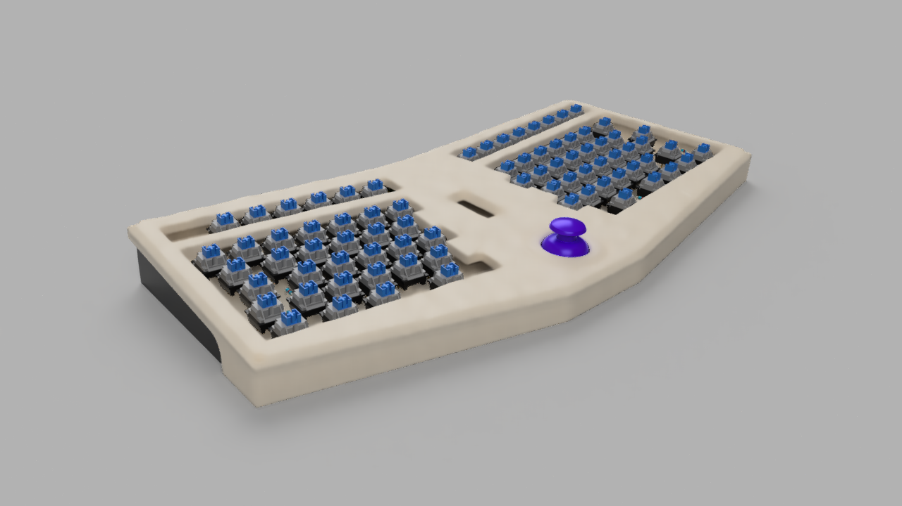
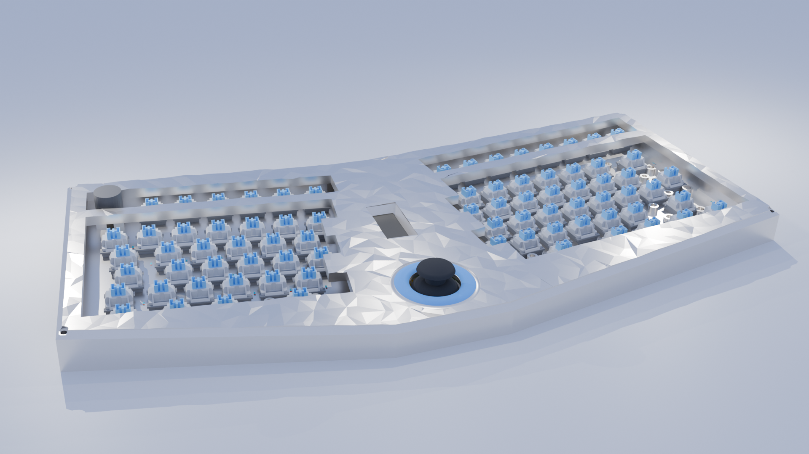
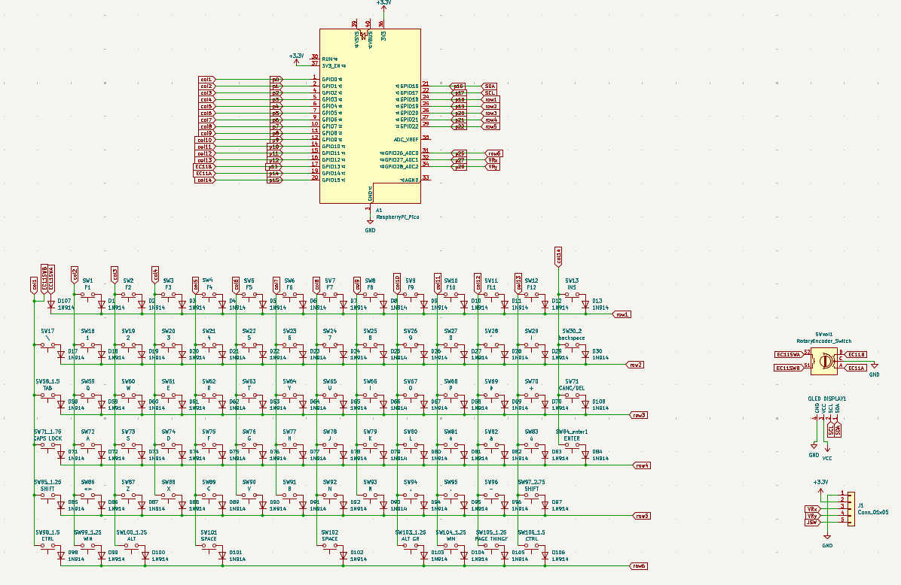
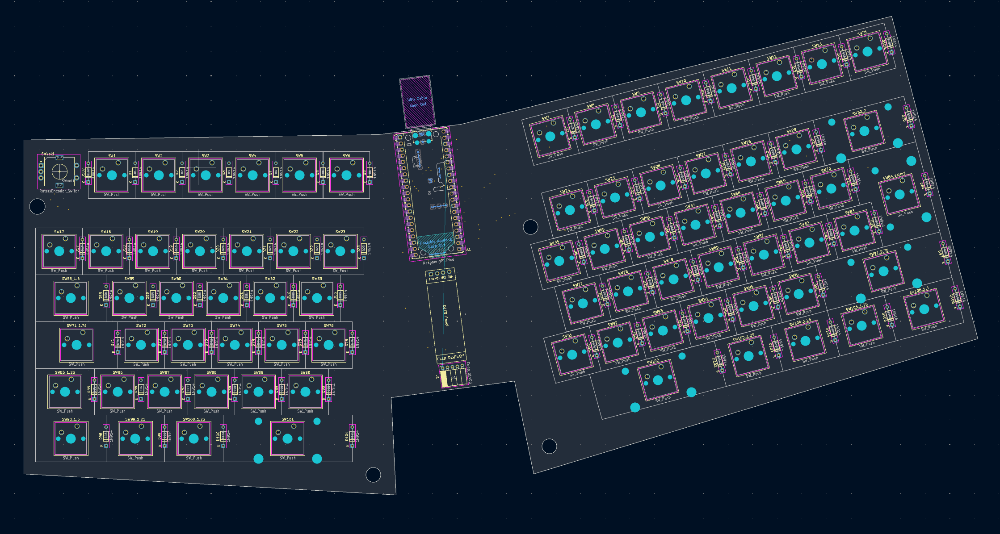

# ***THE BUCKBOARD***

The buckboard is a 60% keyboard with a integrated joystick that simulates the arrow keys and a tiny oled screen.
This project uses a custom raspberry pi pico which can be found here -> ([Fredboard v2](https://github.com/Thebucket-ops/Fredboard)).
Altough the project offers a pcb for the keyboard, the case is made for hand wired keyboard and it should be used just for reference on how to wire up everything (still you could use the pcb, you just need to make some adjustments to the bottom part of the case)

## **CASE**

the case 3d files can be found in /case

## **SCHEMATIC**

This is the schematich for the wiring of the keyboard, each key has its own key written down for ease of use

Each key has to be placed accordingly to how its shown below, the pcb layout is also helpful for wiring so look at it while you wire the keyboard

### **FIRMWARE**

The firmware for the board is made in qmk, the keymap offered has the italian layout.
All files can be found on /firmware.
To flash the firmware simply turn on the devboard on bootloader mode and drag the uf2 file in the devboard.

### **BOM**

  The build requires: 
 - [Fredboard v2](https://github.com/Thebucket-ops/Fredboard) (~20$/pcs)
 - 1 rotary encoder (~15$/10pcs [here](https://www.amazon.it/RUNCCI-YUN-Rotativo-Potenziometro-Digitale-Interruttore/dp/B09SG3HF9N?dib=eyJ2IjoiMSJ9.F8wSD_ClX5zz0PV7IOKvMkRhgyj-cGrY_61fAiASZ94c_mqYwGcYO2LfgHDMmtkLLSino1Pd-_Z8fvpDhx8DIvmlWJccgXqmOFTzvwe1BLPanCgETyudOtUZT9Ufk_3F3Gbc0jFqR6dC4F8MQeamH-wypuVv5iJ48G5n8PrqyaYo7Gsi5FyNlbMGxPjJw6Yv8BhH01mSLIdqSywhAVNpqFnVbQmpprpa9KXmNVoyD8AuH2dO-ndtwUD7AGoTH5E1jhLOjCudrsIiiV8hci9BpDOvhlL3qAmJGjfxH4KTrhQ.eGlkaoZ4o36PyYWL80J3xJWT7rkP3XtXI0fsI0ih9ww&dib_tag=se&keywords=rotary+encoder&qid=1793640223&sr=8-4))
 - 1 joystick moudule (~10$/5pcs [here](https://www.amazon.it/ARCELI-Joystick-Breakout-Module-Arduino/dp/B077Z8QN3S?__mk_it_IT=%C3%85M%C3%85%C5%BD%C3%95%C3%91&crid=3DF8HYTAZMGI1&dib=eyJ2IjoiMSJ9.azcL_6pR9k-VQV-Bp9yBl-ovBqnUR6SjUehkSwaS5Wh2XCvc09OWHMWm41YyFK0PxCOkPQs40QXJPQhbPXYBKEpltBGW_IxIbLmfVi0qSEZw9uFkzg87gOWdravNtxWfebBmtJJjYdWhUvGoGDaQwbiKyFJjyrHCQgyBkecfKQSXlLZfLwYitYo09t7exWX6K8jyDtWcrnj2amiFMB4PMWpjNxR8lnZ5FUU6e6TvTZHMNT-gFap7kG7x7RUsfuPfS4JF8etH_q-v7D0ia59vx2_1AKPquWSYkonLvUhfjZo.Th0ATBVvj1aCIP76Lc_8X88_u4u22PmVYsjqk2jAaZY&dib_tag=se&keywords=joystick+module&qid=1793640403&sprefix=joystick+module%2Caps%2C135&sr=8-4) )
 - 77 keyswitches (~25$/150pcs [here](https://www.amazon.it/gp/product/B0GS645MLG?smid=A227R4NKW6D6GV&psc=1))
 - 78 diodes 1N914 (~15$/100pcs [here](https://www.amazon.it/ALLECIN-1N914-Commutazione-Velocit%C3%A0-200Milliampere/dp/B0CKRKW4HL?__mk_it_IT=%C3%85M%C3%85%C5%BD%C3%95%C3%91&crid=2HW74BA9NU1JU&dib=eyJ2IjoiMSJ9.U0E1T2Xju4EQatSApF4Tuzw-g1WjekXKZoI2FDeSbIZyvY9wVHP5yAVNW3Vx66AwNiZl7wO_9dRpSm7LXVrne4raZd2RQ9-a1_OBjpc72KTMBwaHVpICfEEdncFrTcBiSkuzopNsOFK5EJyBCrTf9OjJ9FrvfwXS666d1NP0-cxf1j37lhCjQzQHDN4vBf_z6tag3rAQaCj6ukxTrlu2u9d0vHg2CzgHsseIyi0e8xsktVY8lT55k3Io6-GlEya16wVekWTCXIJBUyhdD_XkfOiAB7swWxvqeQqY9CAFrlo.hJIcRd5SOuYRWmprUVa64lyLVXWE4hw9tTyIQ5iQS_o&dib_tag=se&keywords=1N914+Diodi&qid=1793639966&s=industrial&sprefix=1n914+diodi%2Cindustrial%2C113&sr=1-1))
 - 1 0.91" oled screen (~17$/3pcs [here](https://www.amazon.it/APKLVSR-display-visualizzazione-Arduino-microcontrollori/dp/B0D2L1ZDWP?__mk_it_IT=%C3%85M%C3%85%C5%BD%C3%95%C3%91&crid=1I0L3VM7VLJUO&dib=eyJ2IjoiMSJ9.IXiposGMPwzMW0L9MnGaq9dgOQjG1XXvP3NgpOOnqSB7DPO5px14HgRE8cgssMzXsi9u6_GTI-vA6X8fb1JW-Zl-8V7hUkKJ1Z0tshoToXaaWXiQBs7qBp4dhLLViAcFUzTobb2ZESK0J-o3noKHusroRZcCWeoEo0rMvEAoog19ZfOoPaCfgOYXG4JijA4dPRZKrdMk-b0gpNwjDoFqHeBUiOdDUzaFT5iyqetnoXpY8Hqazzzcr5Gcd7adHxb1m3fpojiS9mmD4eQ_ZmFuV7_NsCmSS6t_1DXEQXrvp90.dQGyT7EEeWLV01y9welVgTHb6BP5IXY4zm3mwAeLQvw&dib_tag=se&keywords=0.91%22+oled+screen&qid=1793640685&sprefix=0.91+oled+screen%C3%B9%2Caps%2C131&sr=8-1))
 - wire for wiring (~12$/280m of wire [here](https://www.amazon.it/gp/product/B07KB3XVTB?smid=A1XDN6LSMACAXM&psc=1))
 - keycaps (~26$ [here](https://www.amazon.it/gp/product/B0B4JV49DG?smid=A11IL2PNWYJU7H&psc=1))
 Prices may vary based on your region